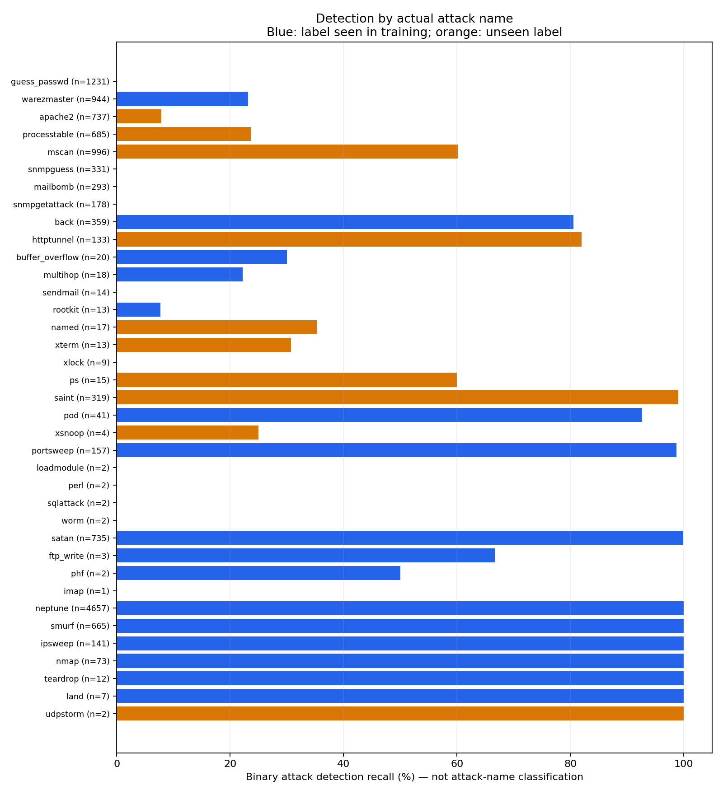

# Đánh giá lại Decision Tree theo từng loại tấn công

Phân tích lại dự đoán đã lưu của model cố định; không train lại, không đổi ngưỡng và không chọn model theo test. Checksum dữ liệu và tổng confusion matrix đã được đối chiếu.

## Model thực sự làm gì?

Model là `DecisionTreeClassifier`, max_depth=12, không phải Random Forest. Cây học các phép chia đặc trưng từ dữ liệu train bằng tiêu chí Gini. Script không đặt một ngưỡng cảnh báo thủ công sau dự đoán. `predict` chọn lớp có tỷ lệ cao nhất tại lá (hòa chọn lớp đầu trong classes_).

Nhãn train đã gộp thành normal/attack nên model chỉ học hai lớp này. Tên tấn công trong báo cáo lấy từ nhãn thật của KDDTest+, không phải tên model tự dự đoán. Thay cây bằng Random Forest nhưng vẫn giữ nhãn nhị phân cũng không tạo được đầu ra tên tấn công.

## Ý nghĩa từng chỉ số và lỗi

- TN = 9433: normal được nhận đúng.
- FP = 278: normal bị báo nhầm là attack.
- FN = 4563: tấn công bị bỏ sót, dự đoán thành normal.
- TP = 8270: phát hiện có tấn công; chưa xác định đúng tên loại tấn công.
- Precision attack = 96.75%: tỷ lệ cảnh báo attack là tấn công thật.
- Recall attack = 64.44%: tỷ lệ tấn công thật được phát hiện; bỏ sót 35.56%.
- F1 attack = 77.36%: trung bình điều hòa precision và recall của lớp attack.
- FPR = 2.86%: tỷ lệ mẫu normal bị báo nhầm; mẫu số là toàn bộ normal.
- Accuracy = 78.53%: tỷ lệ dự đoán nhị phân đúng trên tất cả mẫu; không thể hiện mức độ nhận diện từng loại tấn công.

## Từng nhãn tấn công gốc

Recall dưới đây = số mẫu của loại đó được báo attack / số mẫu test của loại đó. Không phải recall nhận dạng đúng tên loại. Không báo precision/F1 cho từng tên vì model không có dự đoán tên lớp tương ứng. Các loại chỉ có vài mẫu không cho bằng chứng mạnh về khả năng tổng quát hóa.

| Nhãn thật | Số mẫu train | Số mẫu test | Phát hiện attack | Bỏ sót | Recall phát hiện |
| --- | --- | --- | --- | --- | --- |
| guess_passwd | 53 | 1231 | 0 | 1231 | 0.00% |
| warezmaster | 20 | 944 | 219 | 725 | 23.20% |
| apache2 | 0 | 737 | 58 | 679 | 7.87% |
| processtable | 0 | 685 | 162 | 523 | 23.65% |
| mscan | 0 | 996 | 599 | 397 | 60.14% |
| snmpguess | 0 | 331 | 0 | 331 | 0.00% |
| mailbomb | 0 | 293 | 0 | 293 | 0.00% |
| snmpgetattack | 0 | 178 | 0 | 178 | 0.00% |
| back | 956 | 359 | 289 | 70 | 80.50% |
| httptunnel | 0 | 133 | 109 | 24 | 81.95% |
| buffer_overflow | 30 | 20 | 6 | 14 | 30.00% |
| multihop | 7 | 18 | 4 | 14 | 22.22% |
| sendmail | 0 | 14 | 0 | 14 | 0.00% |
| rootkit | 10 | 13 | 1 | 12 | 7.69% |
| named | 0 | 17 | 6 | 11 | 35.29% |
| xterm | 0 | 13 | 4 | 9 | 30.77% |
| xlock | 0 | 9 | 0 | 9 | 0.00% |
| ps | 0 | 15 | 9 | 6 | 60.00% |
| saint | 0 | 319 | 316 | 3 | 99.06% |
| pod | 201 | 41 | 38 | 3 | 92.68% |
| xsnoop | 0 | 4 | 1 | 3 | 25.00% |
| portsweep | 2931 | 157 | 155 | 2 | 98.73% |
| loadmodule | 9 | 2 | 0 | 2 | 0.00% |
| perl | 3 | 2 | 0 | 2 | 0.00% |
| sqlattack | 0 | 2 | 0 | 2 | 0.00% |
| worm | 0 | 2 | 0 | 2 | 0.00% |
| satan | 3633 | 735 | 734 | 1 | 99.86% |
| ftp_write | 8 | 3 | 2 | 1 | 66.67% |
| phf | 4 | 2 | 1 | 1 | 50.00% |
| imap | 11 | 1 | 0 | 1 | 0.00% |
| neptune | 41214 | 4657 | 4657 | 0 | 100.00% |
| smurf | 2646 | 665 | 665 | 0 | 100.00% |
| ipsweep | 3599 | 141 | 141 | 0 | 100.00% |
| nmap | 1493 | 73 | 73 | 0 | 100.00% |
| teardrop | 892 | 12 | 12 | 0 | 100.00% |
| land | 18 | 7 | 7 | 0 | 100.00% |
| udpstorm | 0 | 2 | 2 | 0 | 100.00% |

## Nhãn từng thấy / chưa từng thấy trong toàn bộ KDDTrain+

| type_seen_in_full_train | test_attack_count | detected | missed | type_count | binary_attack_recall |
| --- | --- | --- | --- | --- | --- |
| False | 3750 | 1266 | 2484 | 17 | 0.3376 |
| True | 9083 | 7004 | 2079 | 20 | 0.7711108664538148 |

Seen/unseen ở đây chỉ nói về tên nhãn gốc, không chứng minh nguyên nhân gây lỗi. Cây nhị phân vẫn có thể phát hiện tấn công mang nhãn chưa gặp, nhưng không thể tự đặt tên cho lớp chưa được học.

## Tra cứu từng mẫu sai

Mở `misclassified_records_with_paths.csv`: `source_line_one_based` là số dòng trong KDDTest+.txt; `actual_attack_type` là loại tấn công thật; `predicted_binary` là dự đoán; `outcome` phân biệt FN/FP; `error_meaning` giải thích lỗi. CSV giữ 41 đặc trưng và đường đi `learned_decision_path` qua các ngưỡng cây đã học.

`leaf_attack_fraction_not_calibrated` là tỷ lệ attack tại lá trong dữ liệu fit, không phải xác suất được hiệu chỉnh hay bằng chứng mẫu an toàn. Đường đi giải thích cơ chế quyết định, không chứng minh nguyên nhân thực tế của tấn công. One-hot có giá trị 0/1; ngưỡng 0.5 kiểm tra category có/không.

`false_positives_by_context.csv` gom mẫu normal theo protocol/service/flag kèm số mẫu và FPR; không kết luận các đặc trưng đó là nguyên nhân lỗi chỉ từ bảng thống kê.

## Kết luận và yêu cầu đầu ra

Baseline có giá trị đo khả năng phát hiện có tấn công, nhưng chưa đáp ứng yêu cầu xác định loại tấn công. Precision cao không bù được số lượng lớn tấn công bị bỏ sót. Chênh lệch validation/test cho thấy khả năng tổng quát hóa trên test yếu hơn; riêng chênh lệch này chưa đủ kết luận nguyên nhân duy nhất là overfit.

Nếu đầu ra cần tên tấn công, phải giữ nhãn đa lớp khi train (Decision Tree hoặc Random Forest), đánh giá confusion matrix đa lớp và precision/recall/F1/support từng lớp, macro-F1 và weighted-F1. Nhãn chỉ xuất hiện trong test phải báo riêng; model phân loại đóng không thể học tên lớp chưa có trong train. Nếu thay thiết kế dựa trên phân tích test này, KDDTest+ là dữ liệu phát triển/benchmark đã xem, không còn là tập đánh giá độc lập cho phiên bản mới.
