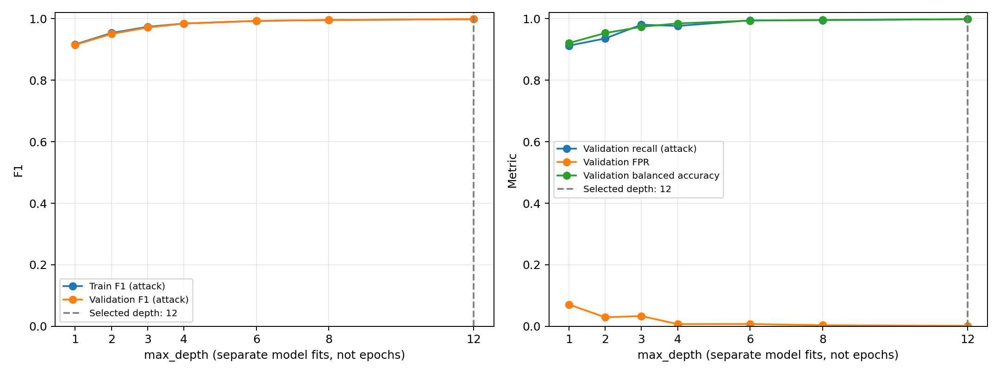
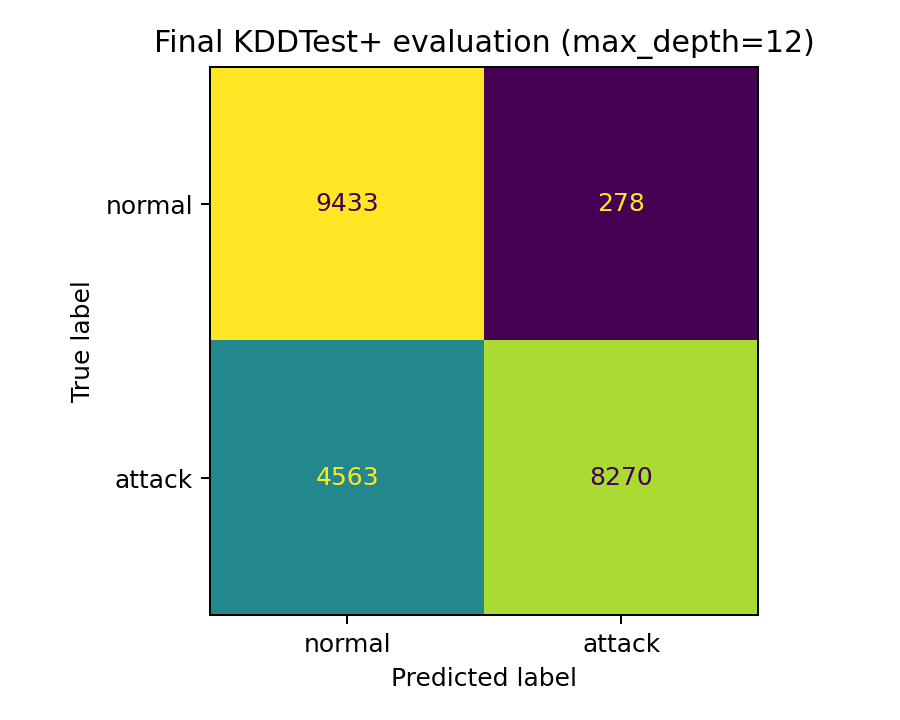

# NSL-KDD Decision Tree baseline

Selected max_depth: **12**. Maximize validation balanced_accuracy = (attack recall + 1 - FPR) / 2; break exact ties by smaller max_depth. Fixed before accessing test data.

Stratified split, seed 42: 100,778 train / 25,195 validation. Final refit: 125,973 records. Test: 22,544 records.

41 input features; one-hot encode protocol_type/service/flag with unknown categories ignored. Label and difficulty excluded.

## Model selection (depths, not epochs)

| max_depth | Train F1 attack | Validation F1 attack | Validation recall attack | Validation FPR | Validation balanced accuracy |
|---:|---:|---:|---:|---:|---:|
| 1 | 0.916340 | 0.915134 | 0.912246 | 0.070904 | 0.920671 |
| 2 | 0.953281 | 0.950199 | 0.935613 | 0.029327 | 0.953143 |
| 3 | 0.973450 | 0.971233 | 0.980385 | 0.033484 | 0.973451 |
| 4 | 0.984211 | 0.983928 | 0.976292 | 0.007127 | 0.984582 |
| 6 | 0.992601 | 0.993018 | 0.994627 | 0.007499 | 0.993564 |
| 8 | 0.995564 | 0.995436 | 0.995054 | 0.003638 | 0.995708 |
| 12 | 0.998326 | 0.998209 | 0.998294 | 0.001633 | 0.998331 |



## Final test (one evaluation, no retuning)

| Metric | Value |
|---|---:|
| precision_attack | 96.747777% |
| recall_attack | 64.443232% |
| f1_attack | 77.358402% |
| false_positive_rate | 2.862733% |
| accuracy | 78.526437% |
| balanced_accuracy | 80.790250% |

Confusion matrix: rows = actual, columns = predicted; order = normal, attack.

```text
[[9433  278]
 [4563 8270]]
```



Final tree: 281 nodes, 141 leaves, 122 encoded features.

Validation and test results describe different data splits; the test result must not be used to tune this baseline. Any later test-driven changes require a new independent evaluation set.

Checks passed: disjoint complete split, training-only encoder categories during selection, saved-model prediction parity, unknown-category inference, 41-column input schema.
