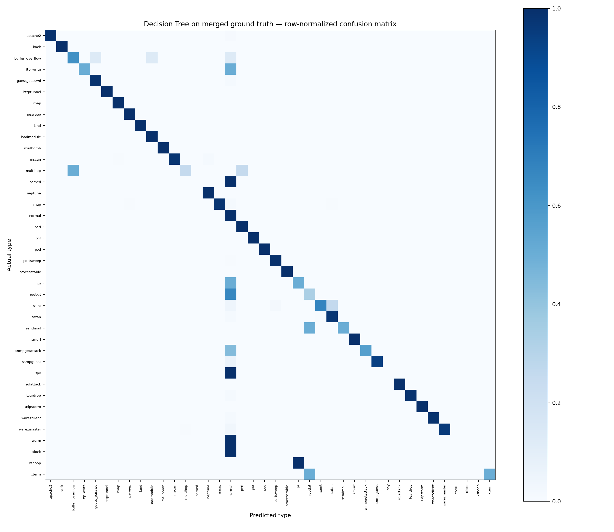

# Decision Tree trên ground truth tổng hợp

Ground truth gộp hai file đầy đủ, loại bản sao theo 41 feature và quarantine vector có nhãn xung đột. Difficulty không được dùng làm feature.

Split seed 42: 103,366 train / 22,152 validation / 22,156 test. Cấu hình chọn trên validation rồi fit lại train+validation; test chỉ được dùng một lần sau lựa chọn.

Cấu hình: max_depth=unlimited, min_samples_leaf=1, actual_depth=50, nodes=2301, leaves=1151.

Đầu vào có 41 feature gốc: 38 số và 3 category. One-hot của ground truth sạch tạo 121 feature cho cây. `feature_schema.json` lưu mapping; `tree_nodes.csv` lưu node/ngưỡng để chuẩn bị chuyển FPGA.

| Test metric | Value |
|---|---:|
| accuracy | 99.43% |
| macro_f1 | 71.24% |
| weighted_f1 | 99.42% |
| binary_precision_attack | 99.63% |
| binary_recall_attack | 99.52% |
| binary_f1_attack | 99.58% |
| binary_false_positive_rate | 0.34% |

| Outcome | Count |
|---|---:|
| correct_type | 22029 |
| missed_attack | 51 |
| false_alarm | 39 |
| wrong_attack_type | 37 |

Macro-F1 test tính trên các lớp hiện diện trong test. Các lớp chỉ có 2 mẫu tổng cộng không có validation; xem class_support.csv. Kết quả thuộc split ground truth riêng, không so sánh trực tiếp với benchmark KDDTrain+/KDDTest+ chuẩn.

Xem per_class_metrics.csv, confusion_pairs.csv và misclassified_records.csv để đánh giá từng loại lỗi.

