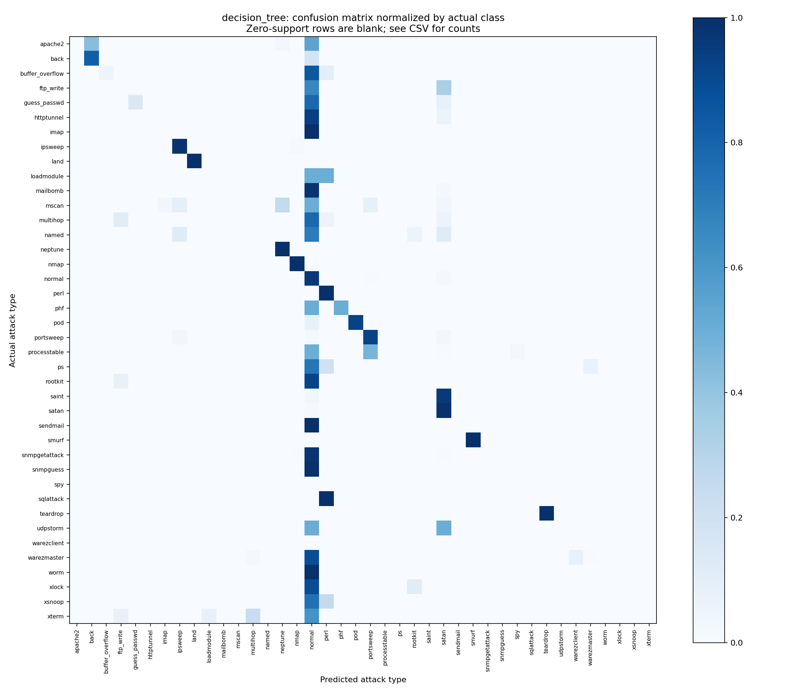

# decision_tree — dự đoán tên loại tấn công

Model chọn bằng validation macro-F1: max_depth=unlimited; macro-F1 validation=71.02%.

Cả hai model dùng cùng split 80/20, seed 42, nhãn gốc đa lớp, one-hot chỉ fit trên train khi chọn cấu hình, class_weight=balanced. Split có ít nhất một mẫu mỗi lớp trong cả train/validation; lớp rất hiếm có 1 mẫu validation nên metric có độ bất định lớn.

KDDTest+ là benchmark đã xem ở lần chạy trước. Không dùng kết quả của lần đánh giá này để đổi cấu hình. Cần dữ liệu độc lập mới để đánh giá phiên bản được phát triển sau khi đã xem benchmark.

Train có 23 lớp; test có 17 nhãn chưa xuất hiện trong train, tổng 3750 mẫu. Model phân loại đóng không thể dự đoán đúng tên lớp chưa được học.

## Metric đa lớp

| Metric | Giá trị |
|---|---:|
| accuracy | 72.31% |
| macro_f1 | 23.63% |
| macro_f1_test_present_classes | 24.87% |
| weighted_f1 | 63.51% |

Macro-F1 mặc định tính trên hợp các nhãn train/test (kể cả lớp không có mẫu test); có thêm macro-F1 chỉ trên lớp hiện diện trong test. Weighted-F1 có trọng số theo support nên dễ bị lớp lớn chi phối.

## Phát hiện có tấn công (gộp từ dự đoán đa lớp)

| Metric | Giá trị |
|---|---:|
| precision_attack | 96.33% |
| recall_attack | 67.66% |
| f1_attack | 79.49% |
| false_positive_rate | 3.41% |
| accuracy | 80.12% |

## Các kiểu lỗi

- correct_type: 16302
- missed_attack: 4150
- wrong_attack_type: 1761
- false_alarm: 331

`false_alarm`: normal bị gọi thành tấn công. `missed_attack`: tấn công bị gọi normal. `wrong_attack_type`: phát hiện có tấn công nhưng gọi sai tên loại. `correct_type`: đúng tên loại (bao gồm normal).

## Precision / recall / F1 từng loại

| Nhãn | Precision | Recall | F1 | Test support | Train support |
|---|---:|---:|---:|---:|---:|
| apache2 | 0.00% | 0.00% | 0.00% | 737 | 0 |
| back | 47.66% | 82.17% | 60.33% | 359 | 956 |
| buffer_overflow | 50.00% | 5.00% | 9.09% | 20 | 30 |
| ftp_write | 0.00% | 0.00% | 0.00% | 3 | 8 |
| guess_passwd | 99.44% | 14.30% | 25.00% | 1231 | 53 |
| httptunnel | 0.00% | 0.00% | 0.00% | 133 | 0 |
| imap | 0.00% | 0.00% | 0.00% | 1 | 11 |
| ipsweep | 54.30% | 98.58% | 70.03% | 141 | 3599 |
| land | 100.00% | 100.00% | 100.00% | 7 | 18 |
| loadmodule | 0.00% | 0.00% | 0.00% | 2 | 9 |
| mailbomb | 0.00% | 0.00% | 0.00% | 293 | 0 |
| mscan | 0.00% | 0.00% | 0.00% | 996 | 0 |
| multihop | 0.00% | 0.00% | 0.00% | 18 | 7 |
| named | 0.00% | 0.00% | 0.00% | 17 | 0 |
| neptune | 94.11% | 99.55% | 96.75% | 4657 | 41214 |
| nmap | 94.81% | 100.00% | 97.33% | 73 | 1493 |
| normal | 69.33% | 96.59% | 80.72% | 9711 | 67343 |
| perl | 16.67% | 100.00% | 28.57% | 2 | 3 |
| phf | 50.00% | 50.00% | 50.00% | 2 | 4 |
| pod | 71.70% | 92.68% | 80.85% | 41 | 201 |
| portsweep | 24.53% | 92.36% | 38.77% | 157 | 2931 |
| processtable | 0.00% | 0.00% | 0.00% | 685 | 0 |
| ps | 0.00% | 0.00% | 0.00% | 15 | 0 |
| rootkit | 0.00% | 0.00% | 0.00% | 13 | 10 |
| saint | 0.00% | 0.00% | 0.00% | 319 | 0 |
| satan | 52.34% | 98.91% | 68.46% | 735 | 3633 |
| sendmail | 0.00% | 0.00% | 0.00% | 14 | 0 |
| smurf | 97.79% | 100.00% | 98.88% | 665 | 2646 |
| snmpgetattack | 0.00% | 0.00% | 0.00% | 178 | 0 |
| snmpguess | 0.00% | 0.00% | 0.00% | 331 | 0 |
| spy | 0.00% | 0.00% | 0.00% | 0 | 2 |
| sqlattack | 0.00% | 0.00% | 0.00% | 2 | 0 |
| teardrop | 24.49% | 100.00% | 39.34% | 12 | 892 |
| udpstorm | 0.00% | 0.00% | 0.00% | 2 | 0 |
| warezclient | 0.00% | 0.00% | 0.00% | 0 | 890 |
| warezmaster | 71.43% | 0.53% | 1.05% | 944 | 20 |
| worm | 0.00% | 0.00% | 0.00% | 2 | 0 |
| xlock | 0.00% | 0.00% | 0.00% | 9 | 0 |
| xsnoop | 0.00% | 0.00% | 0.00% | 4 | 0 |
| xterm | 0.00% | 0.00% | 0.00% | 13 | 0 |

Xem `confusion_pairs.csv` để biết loại A bị gọi thành loại B bao nhiêu lần; `misclassified_records.csv` có từng dòng sai, nhãn thật/dự đoán và 41 đặc trưng. `source_line_one_based` trỏ tới dòng trong KDDTest+.txt.

Số cây: 1; tổng node: 1003; dung lượng model: 255731 byte. Thời gian fit cuối: 3.07s; dự đoán test: 0.039s. Thời gian trên CPU này không phải benchmark FPGA.
