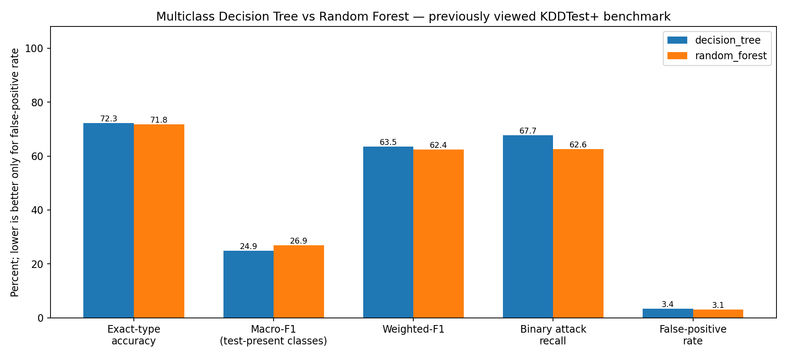

# So sánh Decision Tree và Random Forest đa lớp

Cả hai model dự đoán tên loại tấn công, dùng cùng 41 đặc trưng, cùng split và cùng tiêu chí chọn macro-F1 validation. Model đã fit lại toàn bộ KDDTrain+ sau lựa chọn. Các file run_metadata.json lưu checksum và cấu hình.

KDDTest+ đã được xem ở baseline trước; số liệu dưới đây là benchmark tham khảo. Không lựa chọn lại cấu hình theo bảng này. Một đánh giá độc lập cho phiên bản mới cần dữ liệu mới chưa dùng trong phát triển.

| Chỉ số | Decision Tree | Random Forest |
|---|---:|---:|
| Macro-F1 validation (23 lớp) | 71.02% | 75.46% |
| Accuracy đúng tên loại (test) | 72.31% | 71.82% |
| Macro-F1 trên 38 lớp hiện diện trong test | 24.87% | 26.88% |
| Macro-F1 hợp nhãn train/test (40 lớp) | 23.63% | 25.53% |
| Weighted-F1 (test) | 63.51% | 62.36% |
| Precision phát hiện attack | 96.33% | 96.39% |
| Recall phát hiện attack | 67.66% | 62.56% |
| F1 phát hiện attack | 79.49% | 75.87% |
| FPR trên normal | 3.41% | 3.10% |
| Accuracy đúng tên trên mẫu có nhãn đã học | 86.74% | 86.14% |
| Accuracy đúng tên trên mẫu có nhãn chưa học | 0.00% | 0.00% |

## Mỗi kiểu lỗi là gì?

| Loại kết quả | Ý nghĩa | Decision Tree | Random Forest |
|---|---|---:|---:|
| correct_type | Đúng tên loại, kể cả normal | 16302 | 16190 |
| false_alarm | Normal bị gọi là tấn công | 331 | 301 |
| missed_attack | Tấn công bị gọi là normal | 4150 | 4805 |
| wrong_attack_type | Phát hiện attack nhưng gọi sai tên loại | 1761 | 1248 |

Một mẫu neptune bị dự đoán satan là sai đa lớp, nhưng vẫn là phát hiện attack đúng khi gộp nhị phân. Vì thế metric phát hiện và metric đúng tên loại phải được đọc riêng.

### decision_tree: 10 cặp nhầm nhiều nhất

| Nhãn thật | Dự đoán | Loại lỗi | Số mẫu |
|---|---|---|---:|
| guess_passwd | normal | missed_attack | 959 |
| warezmaster | normal | missed_attack | 836 |
| mscan | normal | missed_attack | 498 |
| apache2 | normal | missed_attack | 402 |
| processtable | normal | missed_attack | 340 |
| snmpguess | normal | missed_attack | 330 |
| processtable | portsweep | wrong_attack_type | 322 |
| apache2 | back | wrong_attack_type | 316 |
| saint | satan | wrong_attack_type | 306 |
| mailbomb | normal | missed_attack | 288 |

### random_forest: 10 cặp nhầm nhiều nhất

| Nhãn thật | Dự đoán | Loại lỗi | Số mẫu |
|---|---|---|---:|
| guess_passwd | normal | missed_attack | 1229 |
| mscan | normal | missed_attack | 696 |
| processtable | normal | missed_attack | 685 |
| apache2 | normal | missed_attack | 680 |
| warezmaster | normal | missed_attack | 462 |
| warezmaster | warezclient | wrong_attack_type | 437 |
| snmpguess | normal | missed_attack | 331 |
| mailbomb | normal | missed_attack | 293 |
| mscan | neptune | wrong_attack_type | 230 |
| saint | satan | wrong_attack_type | 216 |

## So sánh từng loại

| Nhãn | Train support | Test support | DT recall | RF recall | DT F1 | RF F1 |
|---|---:|---:|---:|---:|---:|---:|
| apache2 | 0 | 737 | 0.00% | 0.00% | 0.00% | 0.00% |
| back | 956 | 359 | 82.17% | 97.49% | 60.33% | 98.45% |
| buffer_overflow | 30 | 20 | 5.00% | 5.00% | 9.09% | 7.41% |
| ftp_write | 8 | 3 | 0.00% | 0.00% | 0.00% | 0.00% |
| guess_passwd | 53 | 1231 | 14.30% | 0.00% | 25.00% | 0.00% |
| httptunnel | 0 | 133 | 0.00% | 0.00% | 0.00% | 0.00% |
| imap | 11 | 1 | 0.00% | 0.00% | 0.00% | 0.00% |
| ipsweep | 3599 | 141 | 98.58% | 97.87% | 70.03% | 84.92% |
| land | 18 | 7 | 100.00% | 100.00% | 100.00% | 100.00% |
| loadmodule | 9 | 2 | 0.00% | 0.00% | 0.00% | 0.00% |
| mailbomb | 0 | 293 | 0.00% | 0.00% | 0.00% | 0.00% |
| mscan | 0 | 996 | 0.00% | 0.00% | 0.00% | 0.00% |
| multihop | 7 | 18 | 0.00% | 0.00% | 0.00% | 0.00% |
| named | 0 | 17 | 0.00% | 0.00% | 0.00% | 0.00% |
| neptune | 41214 | 4657 | 99.55% | 98.75% | 96.75% | 96.40% |
| nmap | 1493 | 73 | 100.00% | 100.00% | 97.33% | 70.19% |
| normal | 67343 | 9711 | 96.59% | 96.90% | 80.72% | 78.66% |
| perl | 3 | 2 | 100.00% | 50.00% | 28.57% | 50.00% |
| phf | 4 | 2 | 50.00% | 50.00% | 50.00% | 66.67% |
| pod | 201 | 41 | 92.68% | 95.12% | 80.85% | 72.22% |
| portsweep | 2931 | 157 | 92.36% | 96.18% | 38.77% | 80.11% |
| processtable | 0 | 685 | 0.00% | 0.00% | 0.00% | 0.00% |
| ps | 0 | 15 | 0.00% | 0.00% | 0.00% | 0.00% |
| rootkit | 10 | 13 | 0.00% | 0.00% | 0.00% | 0.00% |
| saint | 0 | 319 | 0.00% | 0.00% | 0.00% | 0.00% |
| satan | 3633 | 735 | 98.91% | 99.73% | 68.46% | 74.99% |
| sendmail | 0 | 14 | 0.00% | 0.00% | 0.00% | 0.00% |
| smurf | 2646 | 665 | 100.00% | 100.00% | 98.88% | 99.85% |
| snmpgetattack | 0 | 178 | 0.00% | 0.00% | 0.00% | 0.00% |
| snmpguess | 0 | 331 | 0.00% | 0.00% | 0.00% | 0.00% |
| spy | 2 | 0 | 0.00% | 0.00% | 0.00% | 0.00% |
| sqlattack | 0 | 2 | 0.00% | 0.00% | 0.00% | 0.00% |
| teardrop | 892 | 12 | 100.00% | 100.00% | 39.34% | 39.34% |
| udpstorm | 0 | 2 | 0.00% | 0.00% | 0.00% | 0.00% |
| warezclient | 890 | 0 | 0.00% | 0.00% | 0.00% | 0.00% |
| warezmaster | 20 | 944 | 0.53% | 1.06% | 1.05% | 2.09% |
| worm | 0 | 2 | 0.00% | 0.00% | 0.00% | 0.00% |
| xlock | 0 | 9 | 0.00% | 0.00% | 0.00% | 0.00% |
| xsnoop | 0 | 4 | 0.00% | 0.00% | 0.00% | 0.00% |
| xterm | 0 | 13 | 0.00% | 0.00% | 0.00% | 0.00% |

Các nhãn có train support = 0 chưa được học; recall đúng tên bằng 0 không có nghĩa model luôn bỏ sót mọi mẫu đó — model có thể gọi chúng là một loại tấn công khác. Các lớp có support rất nhỏ không đủ để kết luận vững chắc. Macro-F1 cân bằng trọng số các lớp; weighted-F1 ưu tiên lớp nhiều mẫu.

## Chi phí model

| Đại lượng | Decision Tree | Random Forest |
|---|---:|---:|
| tree_count | 1 | 200 |
| total_nodes | 1003 | 112536 |
| total_leaves | 502 | 56368 |
| model_file_bytes | 255731 | 28032842 |
| final_fit_seconds | 3.0676922000129707 | 10.783739699982107 |
| test_predict_seconds | 0.03947019996121526 | 0.3234234999981709 |

Thời gian đo trên CPU trong lần chạy này, không phải độ trễ FPGA; chưa có benchmark lặp lại. Random Forest 200 cây có chi phí lưu trữ/tính toán lớn hơn một cây. Bảng này so sánh các cấu hình đã thử, không khẳng định thuật toán nào luôn tốt hơn.

Chi tiết mẫu sai: `../decision_tree_multiclass/misclassified_records.csv` và `../random_forest_multiclass/misclassified_records.csv`. Bảng cặp nhầm: `confusion_pairs.csv` trong từng thư mục. Chỉ số dòng là dòng gốc trong KDDTest+.txt.
